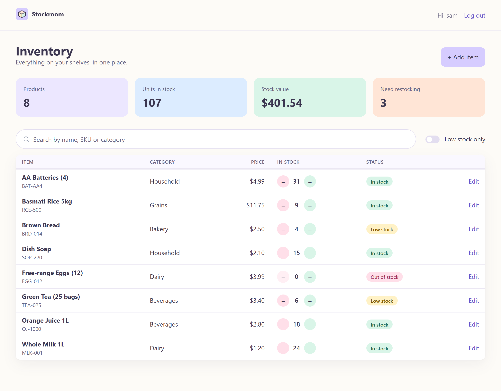
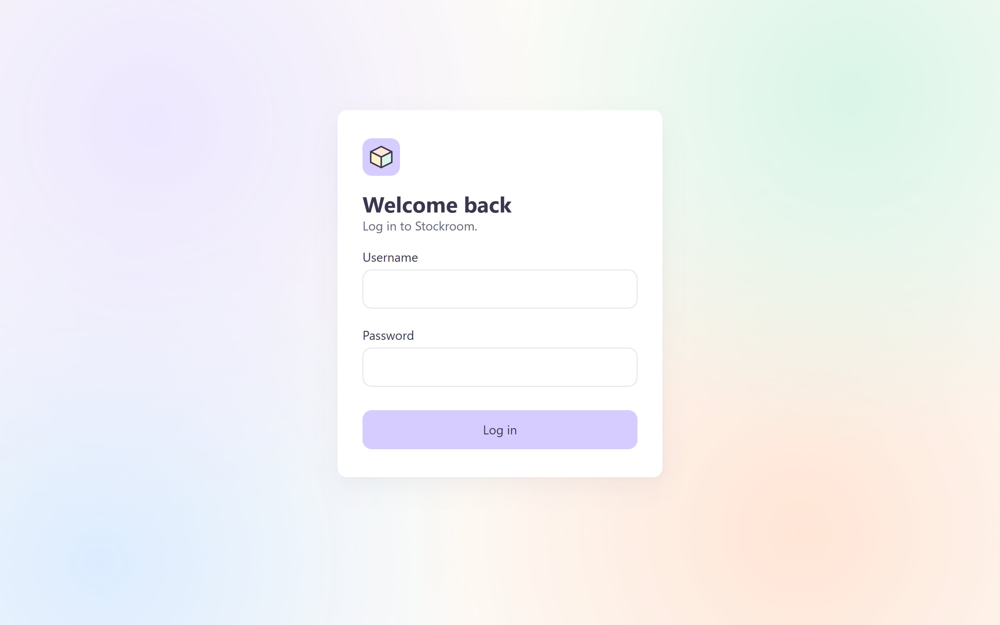
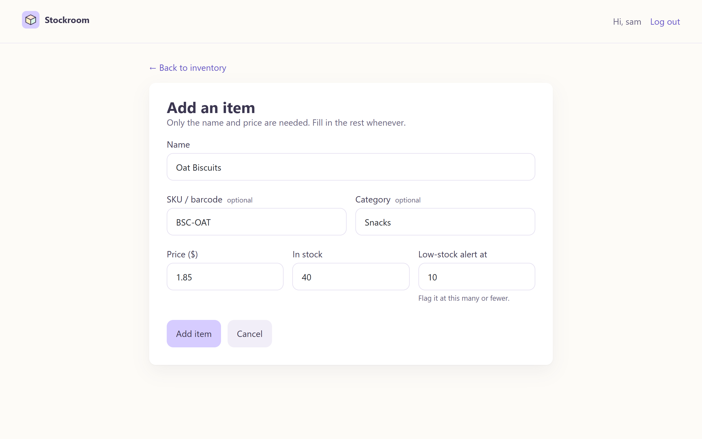
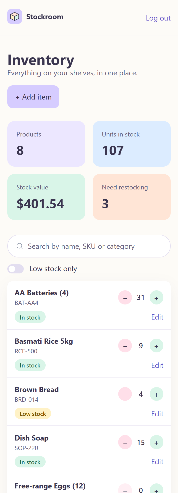

# Stockroom

A small, friendly inventory manager for small shops.
Python, Flask and SQLite on the back end; plain HTML, CSS and JavaScript on the front, styled with [Pico.css](https://picocss.com) and a pastel theme.



## What it does

- **Login**: the first visit asks you to create an account, then it's a normal login page.
- **Inventory list**: every item with its price, stock level and an *In stock / Low stock / Out of stock* badge.
- **Quick − / + buttons** to adjust stock as things sell or arrive.
- **Add, edit and delete items**: name, SKU or barcode, category, price, quantity and a low-stock alert level.
- **Live search** and a *Low stock only* switch for making a restock list.
- **Totals at a glance**: products, units in stock, stock value and how many items need restocking.

## Screenshots

| Log in | Add an item |
| --- | --- |
|  |  |

On a phone, each item turns into a card:



## Run it

You need Python 3.9 or newer.

```bash
pip install -r requirements.txt
python app.py
```

Then open <http://127.0.0.1:5000>.

## Where things are

| File | What's in it |
| --- | --- |
| `app.py` | The pages and actions: login, inventory, add/edit/delete |
| `db.py` | Every database query |
| `schema.sql` | The database tables |
| `templates/` | The HTML pages |
| `static/style.css` | The pastel theme |
| `static/app.js` | Live search, the − / + buttons, delete confirmation |
| `static/vendor/pico.min.css` | [Pico.css](https://picocss.com) v2.1.1, kept locally so the app works offline |

Your data lives in `instance/inventory.db`, a single SQLite file. Copy it somewhere safe to back it up.

## Make it yours

- **Shop name and currency**: change `SHOP_NAME` and `CURRENCY` at the top of `app.py`.
- **Colours**: the palette is at the top of `static/style.css`.

---

Created in [T3 Code](https://t3.codes).
